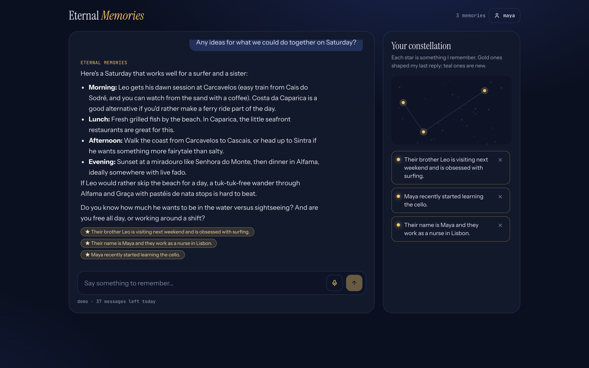
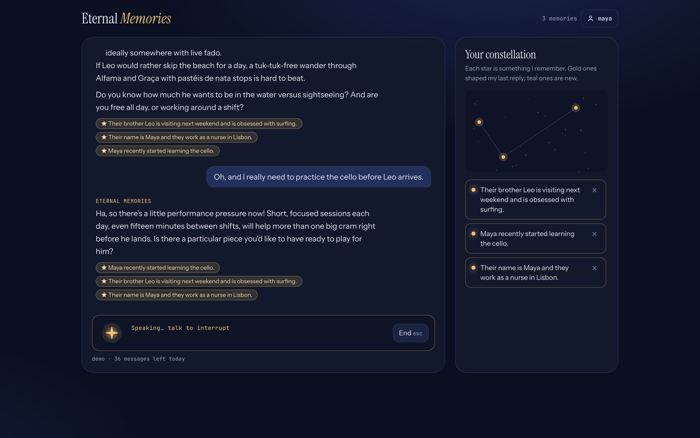
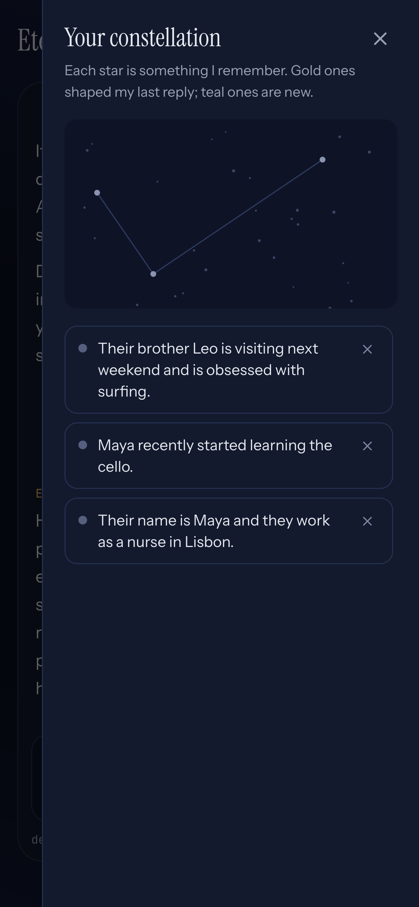
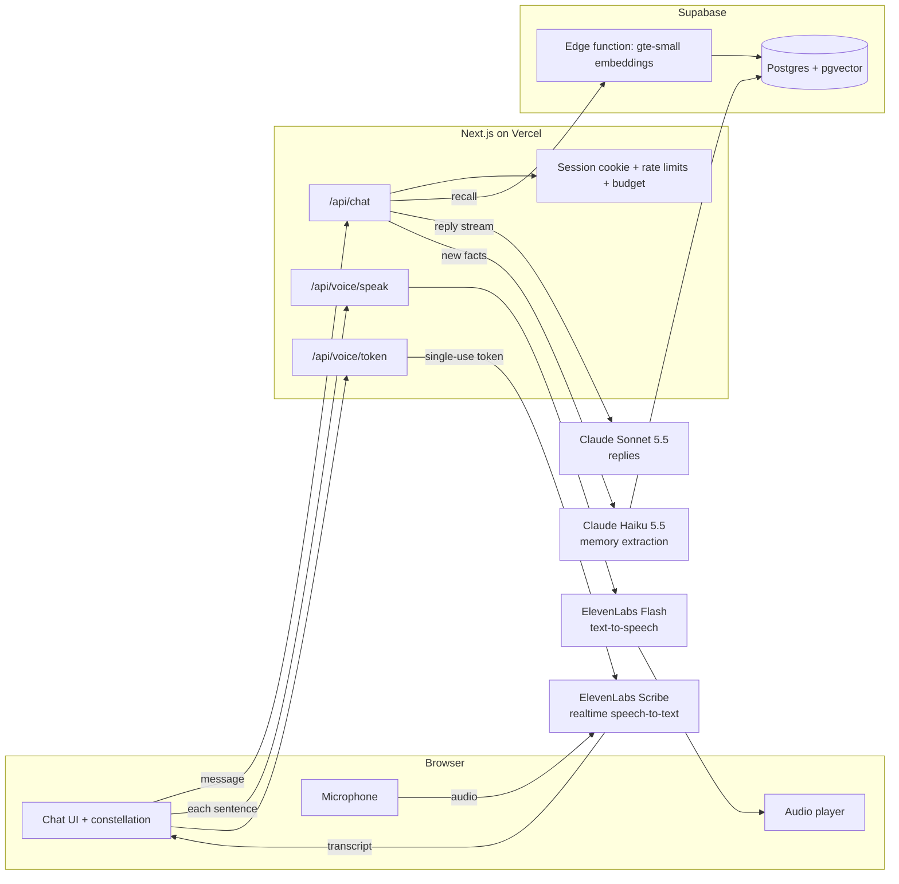

# Eternal Memories

**An AI companion that remembers.** Talk or type with it, and it keeps the people, plans and
things you care about as a constellation of memories, then brings them up when they matter,
days or weeks later. Every memory is visible, and you can make it forget any of them.



**Live demo:** coming soon · **Built by** Benjapon Kruthanooch

## What it does

- **Long-term memory.** After each exchange, Claude picks out lasting facts ("Their brother Leo
  is visiting next weekend") and stores them. Later conversations recall the relevant ones, and
  each reply shows which memories it drew on (★) and what it learned (+ New star).
- **Hands-free voice.** Tap the mic and just talk. It notices when you've finished, answers out
  loud sentence by sentence, and stops when you talk over it, like a real conversation.
- **Your constellation.** A star map and list of everything it remembers. Gold stars shaped the
  last reply and teal ones are new. Remove a single memory or erase everything.
- **Private by design.** No account needed. Each browser gets its own signed, httpOnly
  session, and nothing is shared between visitors.

| Voice conversation | On a phone |
| --- | --- |
|  |  |

## How it works



**Memory, step by step**

1. The message is embedded with Supabase's built-in `gte-small` model and the 12 closest
   memories are fetched with pgvector.
2. They're given to Claude Sonnet 5.5 as a *mid-conversation system message*, which keeps the
   main system prompt stable and marks memories as context, not something the user said.
3. The reply streams back. Claude Haiku 5.5 then reads the exchange and returns new facts as
   structured output. Each fact is deduplicated against existing memories, and corrections
   ("Porto, not Lisbon") replace the old fact.

Design notes that came from testing:

- **No similarity cut-off for recall.** With `gte-small`, indirect matches ("the school run was
  chaos" → "daughter just started school") score about 0.79–0.80, close to unrelated facts at
  0.73–0.77. So recall passes the 12 nearest memories and lets Claude judge relevance. A person
  has tens of memories, not thousands, so this costs little.
- **Corrections skip the duplicate check.** "Married in Porto" and "married in Lisbon" embed as
  near-duplicates, so a correction is applied as a replacement first.
- **Passing moods aren't memories.** The extractor ignores one-off states like "had a rough day".

**Voice, step by step**

- The browser streams the microphone to ElevenLabs Scribe v2 Realtime using a single-use token
  minted by the server, so the API key never reaches the browser. Voice activity detection
  ends your turn after about one second of silence.
- The transcript goes through the same `/api/chat` pipeline as typed messages, in a voice
  mode that asks for short, Markdown-free replies.
- As the reply streams, it is cut into sentences. Each one is synthesised by ElevenLabs Flash
  v2.5 (about 150–330 ms to first audio) and played in order, so speech starts before the reply
  is finished. Hearing two or more words while it is speaking stops playback (barge-in).

## Safety and cost

A public demo of paid APIs needs to stay safe to leave running. The server enforces:

| Limit | Default |
| --- | --- |
| Total estimated spend, all visitors, rolling 24 h | $2.00 |
| Spend per visitor, rolling 24 h | $0.30 |
| Messages per visitor | 5 a minute, 40 a day |
| Per network | 100 messages and 5 new sessions a day |
| Reply length | 1,024 tokens; messages up to 2,000 characters |

Every request's cost is estimated from real token and character counts and logged in Postgres.
An unknown model (for example, a safety fallback) is priced at the most expensive rate. All
limits can be changed with `DEMO_*` environment variables, and spend limits on the Anthropic
workspace and the ElevenLabs key act as a final backstop.

Measured costs: about **$0.004 per text reply** (reply plus memory extraction), about **$0.002
per spoken sentence**, and **$0.03 per 5 minutes of listening**.

Sessions are random IDs in an HMAC-signed, httpOnly, `SameSite=Lax` cookie. Every API route
takes the user from the cookie and never from the request, and Supabase tables have row-level
security on with no policies, so only the server's secret key can reach them.

## Tech stack

Next.js 16 (App Router) · React 19 · TypeScript · Tailwind CSS 4 · Anthropic SDK (Claude Sonnet
5.5 and Haiku 5.5) · Supabase Postgres + pgvector + Edge Functions · ElevenLabs (Scribe v2
Realtime, Flash v2.5) · Playwright + axe-core · Vercel

## Run it locally

You need free Supabase, Anthropic and ElevenLabs accounts. [docs/SETUP.md](docs/SETUP.md) walks
through each step: database migrations, the embedding function, API keys and `.env.local`.

```bash
pnpm install
pnpm build && pnpm start
```

## Tests

```bash
pnpm test:e2e        # free: mocks the API and the ElevenLabs socket
pnpm test:e2e:live   # opt-in: real Claude, Supabase and ElevenLabs (a few cents)
```

- **Mocked suite (15 tests).** Covers the chat flow, recalled and new memory chips, forgetting,
  limits, the phone drawer, specific microphone errors, a full hands-free voice turn against a
  mocked Scribe socket, and axe WCAG 2.2 A/AA scans with no violations.
- **Live suite.** Checks that a fact is remembered and used later, and runs a complete voice
  turn using an ElevenLabs-generated recording as Chrome's fake microphone.

## History

This started as a quick v0 prototype that sent each message to an n8n workflow, with Zep as the
memory store. When n8n deprecated its Zep node, the workflow and the live demo broke. It was
rebuilt from that prototype: n8n and Zep were replaced with direct Claude and pgvector calls in
Next.js route handlers, and real sessions, demo cost controls, hands-free voice, a new design,
accessibility work and end-to-end tests were added.
