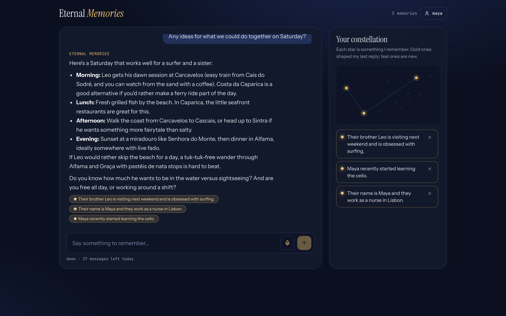
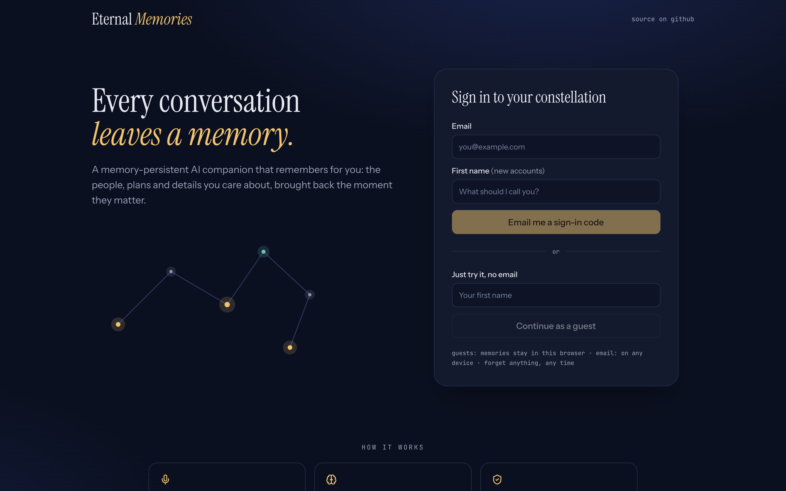
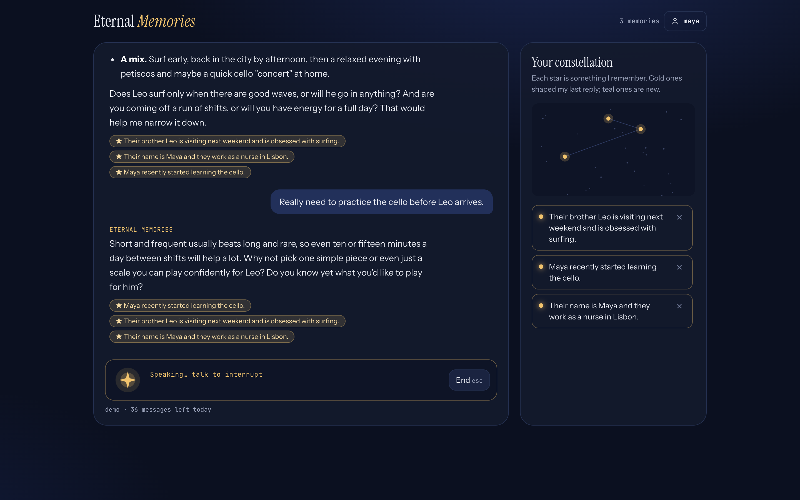
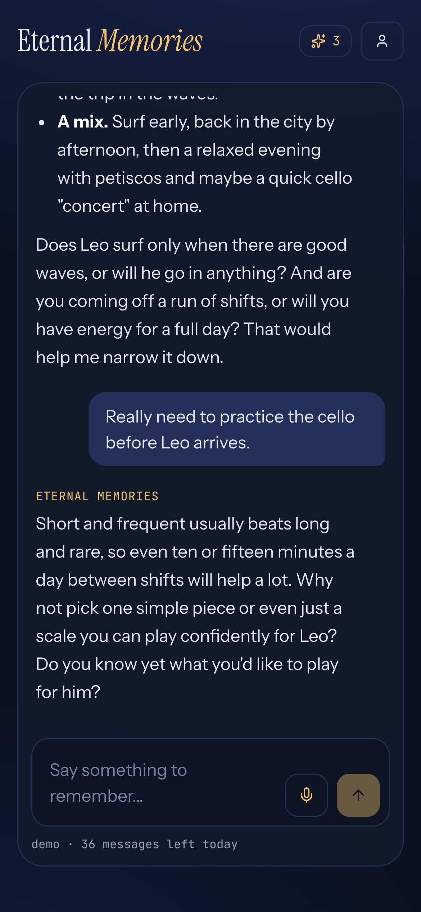
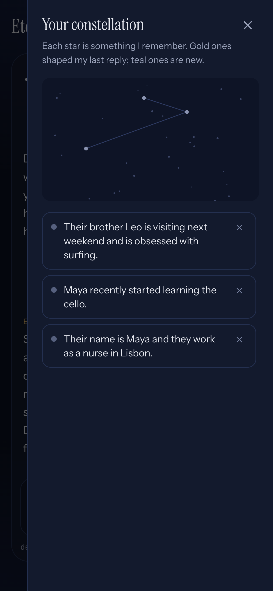
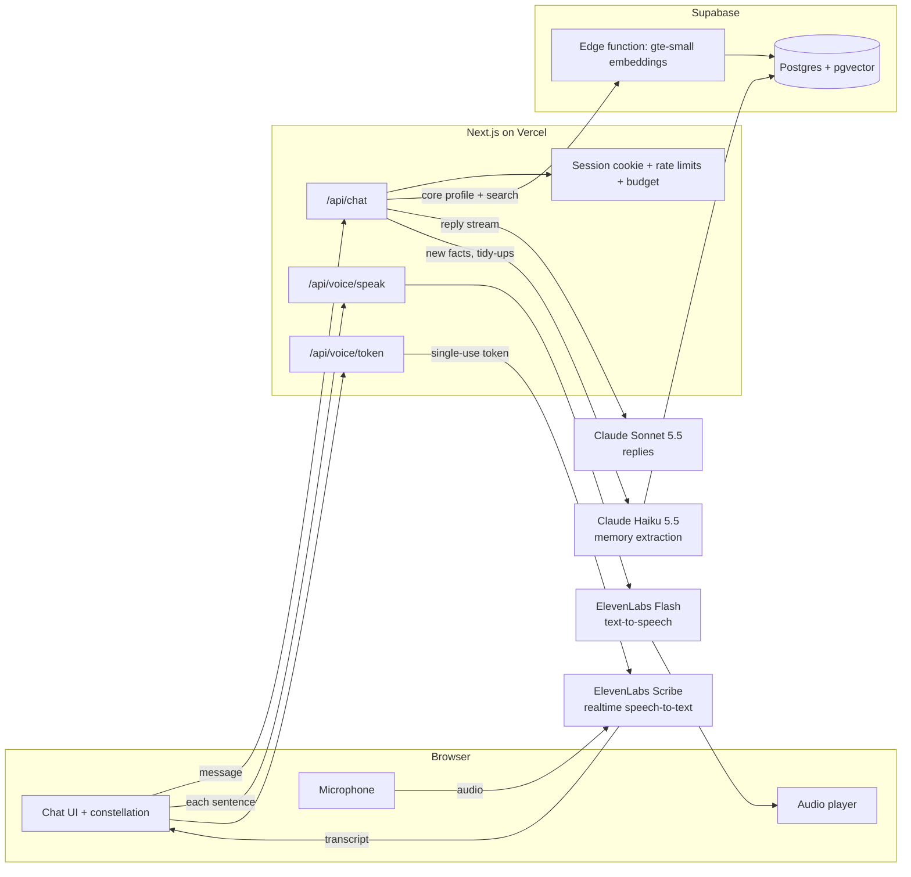

# Eternal Memories

**Every conversation leaves a memory.** A memory-persistent AI companion that remembers for you:
the people, plans and details you care about, kept as a constellation of memories and brought back
the moment they matter, days or weeks later. Talk or type with it. Every memory is visible, and you can make it forget any of them.



**Live demo:** [eternalmemories.space](https://eternalmemories.space) · **Built by** Benjapon Kruthanooch

## What it does

- **Long-term memory.** After each exchange, Claude picks out lasting facts ("Their brother Leo
  is visiting next weekend") and stores them. Later conversations recall the relevant ones, and
  each reply shows which memories it drew on (★) and what it learned (+ New star).
- **Hands-free voice.** Tap the mic and just talk. It notices when you've finished, answers out
  loud sentence by sentence, and stops when you talk over it, like a real conversation.
- **Your constellation.** A star map and list of everything it remembers. Gold stars shaped the
  last reply and teal ones are new. Remove a single memory or erase everything.
- **Sign in your way.** Use an emailed 6-digit code to keep your memories on any device, or
  just try it as a guest. A guest who adds an email later keeps everything.
- **Sign in with your face.** After the first email sign-in, turn on face sign-in and come back
  with Face ID, a fingerprint or the device PIN: no email or code to remember. It uses
  passkeys, so the face never leaves the device and the app stores no biometric data.
- **Private by design.** Identity lives in a signed, httpOnly session cookie, sign-in codes
  are stored only as hashes, and nothing is shared between visitors.

| Sign in with email or as a guest | Voice conversation |
| --- | --- |
|  |  |

| On a phone | The constellation on a phone |
| --- | --- |
|  |  |

## How it works



**Memory, step by step**

1. **Always in mind.** The person's core profile (their name, closest people, health and
   medications, routines, home, what to do in an emergency, plus anything they pinned) is
   included with every reply, grouped by kind. It never depends on search.
2. **Search by meaning and keyword.** The message is embedded with Supabase's built-in
   `gte-small` model. `search_memories` takes the 40 closest memories by meaning and the 40 best
   Postgres full-text matches (so names like "Dr. Patel" match exactly), merges them with
   reciprocal rank fusion and returns the top 12. It scans that person's memories exactly,
   because filtering a shared HNSW index by person can silently return too few.
3. Both go to Claude Sonnet 5.5 as a *mid-conversation system message*, which keeps the main
   system prompt stable and marks memories as context, not something the user said.
4. The reply streams back. Claude Haiku 5.5 then reads the exchange and returns new facts as
   structured output, each with a category, a subject ("Leo") and whether it's core. Facts are
   deduplicated, and corrections ("Lisbon, not Porto") retire the old fact and keep its pin.
5. **Tidy-ups.** After 25 new memories, or a week, Haiku reviews everything in the background
   (Next.js `after()`): it merges overlapping memories, rewords vague ones, retires outdated
   ones and adjusts the core profile. It never invents facts or touches pinned memories.
   Every change is listed in the app with an Undo button, and set-aside memories are kept for
   30 days.

**How it talks.** The companion has the warmth of a best friend, the listening of a good
therapist and the patience of a caring relative, and it says plainly that it's an AI and none of
those professionals. On a new visit (after 3 hours or more) it speaks first: hello by name, then
one question that follows up on last time ("How did the scan go?"), working out from real dates
whether an event has happened yet. It never says "as I told you", answers repeated questions
afresh, doesn't advise on medication, points to emergency help when someone may be in danger, and
encourages the people already in their life. When someone seems to have forgotten a death, it
responds to the feeling first and tells the truth gently if asked directly.

**Linked memories.** When a memory comes up, others about the same person come with it, and the
constellation's lines join related memories rather than following time order.

**Measured** with `scripts/memory-eval` (a test person with 410 memories and 32 realistic
questions, e.g. "Did I take my evening pill?"):

| | Before | After |
| --- | --- | --- |
| Right memory reached Claude | 85% | 88% |
| Core facts in front of Claude on any question | 6% | 88–100% |
| Questions where an outdated fact was also shown | 5 | 0 |

A tidy-up of all 410 memories cost about $0.005 and took 35 seconds in the background. Without
any core flags to start from, it found 14 of the 16 expected core facts.

Design notes that came from testing:

- **No similarity cut-off for recall.** With `gte-small`, indirect matches ("the school run was
  chaos" → "daughter just started school") score about 0.79–0.80, close to unrelated facts at
  0.73–0.77. So recall passes the 12 best memories and lets Claude judge relevance.
- **Corrections skip the duplicate check.** "Married in Porto" and "married in Lisbon" embed as
  near-duplicates, so a correction is applied as a replacement first.
- **Passing moods aren't memories.** The extractor ignores one-off states like "had a rough day".

**Voice, step by step**

- The browser streams the microphone to ElevenLabs Scribe v2 Realtime using a single-use token
  minted by the server, so the API key never reaches the browser. Voice activity detection
  ends your turn after about one second of silence.
- The transcript goes through the same `/api/chat` pipeline as typed messages, in a voice
  mode that asks for short, Markdown-free replies.
- As the reply streams, it is cut into sentences. Each one is synthesised by ElevenLabs Flash
  v2.5 (about 150–330 ms to first audio) and played in order, so speech starts before the reply
  is finished. Hearing two or more words while it is speaking stops playback (barge-in).

## Safety and cost

A public demo of paid APIs needs to stay safe to leave running. The server enforces:

| Limit | Default |
| --- | --- |
| Total estimated spend, all visitors, rolling 24 h | $2.00 |
| Spend per visitor, rolling 24 h | $0.30 |
| Messages per visitor | 5 a minute, 40 a day |
| Per network | 100 messages and 5 new sessions a day |
| Reply length | 1,024 tokens; messages up to 2,000 characters |

Every request's cost is estimated from real token and character counts and logged in Postgres.
An unknown model (for example, a safety fallback) is priced at the most expensive rate. All
limits can be changed with `DEMO_*` environment variables, and spend limits on the Anthropic
workspace and the ElevenLabs key act as a final backstop.

Measured costs: about **$0.004 per text reply** (reply plus memory extraction), about **$0.002
per spoken sentence**, and **$0.03 per 5 minutes of listening**.

Sessions are IDs in an HMAC-signed, httpOnly, `SameSite=Lax` cookie: random for guests,
stable for email accounts. Sign-in codes are 6 digits, stored only as HMACs, valid for 10
minutes, single use, locked after 5 wrong tries (checked atomically in Postgres) and rate
limited per address and per network. The request endpoint answers identically for known and
unknown addresses, so it can't be used to find out who has an account. Every API route
takes the user from the cookie and never from the request, and Supabase tables have row-level
security on with no policies, so only the server's secret key can reach them.

Face sign-in is WebAuthn (passkeys via SimpleWebAuthn): discoverable credentials with user
verification required, so the device unlocks them with face, fingerprint or PIN. Only the public
key is stored. Each challenge is single use (consumed atomically in Postgres), expires after 5
minutes and is rate limited per network, and the request's origin must be the site's own
address.

## Tech stack

Next.js 16 (App Router) · React 19 · TypeScript · Tailwind CSS 4 · Resend · SimpleWebAuthn · Anthropic SDK (Claude Sonnet
5.5 and Haiku 5.5) · Supabase Postgres + pgvector + Edge Functions · ElevenLabs (Scribe v2
Realtime, Flash v2.5) · Playwright + axe-core · Vercel

## Run it locally

You need free Supabase, Anthropic and ElevenLabs accounts. [docs/SETUP.md](docs/SETUP.md) walks
through each step: database migrations, the embedding function, API keys and `.env.local`.

```bash
pnpm install
pnpm build && pnpm start
```

## Tests

```bash
pnpm test:e2e        # free: mocks the API and the ElevenLabs socket
pnpm test:e2e:live   # opt-in: real Claude, Supabase and ElevenLabs (a few cents)
node --env-file=.env.local scripts/memory-eval/run.mjs baseline|upgrade|tidy   # memory recall test
```

- **Mocked suite (44 tests).** Covers the chat flow, the opening greeting, recalled and new memory chips, forgetting,
  pinning, the "Always in mind" group, tidy-up undo, email and face sign-in (with Chrome's
  virtual authenticator), limits, the phone drawer, specific microphone errors, a full
  hands-free voice turn against a mocked Scribe socket, and axe WCAG 2.2 A/AA scans with no
  violations.
- **Live suite.** Checks that a fact is remembered and used later, and runs a complete voice
  turn using an ElevenLabs-generated recording as Chrome's fake microphone.

## History

This started as a quick v0 prototype that sent each message to an n8n workflow, with Zep as the
memory store. When n8n deprecated its Zep node, the workflow and the live demo broke. It was
rebuilt from that prototype: n8n and Zep were replaced with direct Claude and pgvector calls in
Next.js route handlers, and real sessions, demo cost controls, hands-free voice, a new design,
accessibility work and end-to-end tests were added.
